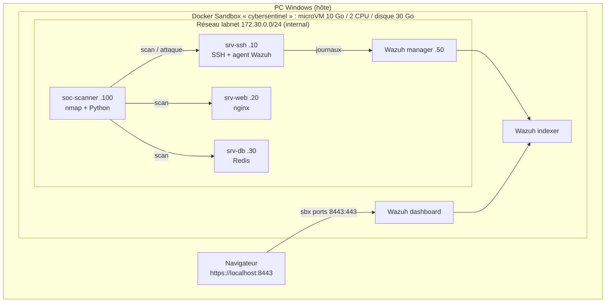

# CyberSentinel AI

> PoC Blue Team / SOC : découverte d'actifs, centralisation SIEM/XDR, détection et investigation assistée par IA, dans un laboratoire isolé et portable.


---

## Objectif

Démontrer une chaîne de défense complète dans un environnement contrôlé :

```
Découverte des actifs → Inventaire → SIEM/XDR → Surveillance → Détection → Investigation IA → Rapport
```

Principe de base : **on ne peut pas protéger ce qu'on ne connaît pas.**

## Principes du dépôt

| Principe | Application |
|---|---|
| **Portabilité** | Tout le labo est décrit en code dans ce dépôt. `git clone` + quelques commandes = labo reconstruit. |
| **Isolation** | Le labo tourne dans une sandbox Docker Sandboxes (microVM), sur un réseau interne **sans accès Internet**. |
| **Ressources limitées** | Sandbox plafonnée à **10 Go de RAM / 2 CPU**, pour tourner sur des machines à 16 Go. Chaque conteneur a un `mem_limit`. |
| **Aucun secret dans Git** | Clés API et mots de passe dans `.env` (ignoré). Seul `.env.example` est versionné. |

## Architecture



| Composant | Rôle | Statut |
|---|---|---|
| Docker Sandboxes (`sbx`) | Isolation microVM du labo | ✅ |
| Docker Compose | Déploiement des services du labo | ✅ |
| Machines cibles | srv-ssh, srv-web, srv-db | ✅ |
| Python + nmap | Découverte et inventaire des actifs | ✅ |
| Wazuh 4.14.9 (SIEM/XDR) | Centralisation, détection, audit de configuration | ✅ |
| Agent Wazuh sur srv-ssh | Collecte des journaux d'authentification | ✅ |
| Goose + MCP | Agent IA et accès contrôlé aux alertes | ⏳ Étape 4 |
| NVIDIA NIM API | Modèle IA pour l'analyse | ⏳ Étape 4 |

## Budget RAM (mesuré)

| Service | Limite | Utilisation réelle |
|---|---|---|
| Wazuh indexer (Java 1 Go) | 2 Go | ~1,3 Go |
| Wazuh manager | 1 Go | ~320 Mo |
| Wazuh dashboard | 1 Go | ~240 Mo |
| srv-ssh (+ agent) | 512 Mo | faible |
| srv-web, srv-db | 64 Mo chacun | ~4 Mo chacun |
| soc-scanner | 256 Mo | < 1 Mo au repos |
| **Total** | **~5 Go** | **~1,9 Go** |

## Prérequis

- Windows 11 avec **Windows Hypervisor Platform** activé
- **Git** : `winget install --id Git.Git -e`
- **Docker Sandboxes** : `winget install Docker.sbx` puis `sbx login`
- 16 Go de RAM minimum et ~30 Go de disque libre

## Installation complète

### 1. Sur Windows (PowerShell)

```powershell
# Récupérer le projet (hors OneDrive)
mkdir C:\Projets ; cd C:\Projets
git clone https://github.com/CaptaineNemo1995/IA-Project-digitalisation.git cybersentinel-ai
cd cybersentinel-ai
copy .env.example .env        # puis remplir les mots de passe dans .env

# Disque Docker de la sandbox : 30 Go (le défaut de 10 Go est trop petit pour Wazuh)
sbx settings set sandbox.disk.dockerVolume 30g

# Domaines à autoriser par la politique réseau
sbx policy allow network deb.debian.org
sbx policy allow network packages.wazuh.com

# Créer la sandbox et y entrer (choisir la politique réseau 2 « Balanced »)
sbx run shell --name cybersentinel --memory 10g --cpus 2 .
```

### 2. Dans la sandbox (`agent@cybersentinel`)

```bash
# Raccourci : « docker compose » vise directement le labo
echo 'export COMPOSE_FILE=lab/docker-compose.yml COMPOSE_ENV_FILES=.env' >> ~/.bashrc
source ~/.bashrc

docker compose up -d --build      # labo (~10 min la première fois)
bash scripts/setup-siem.sh        # Wazuh (~5 min la première fois)
```

### 3. Accéder au dashboard Wazuh (PowerShell)

```powershell
sbx ports cybersentinel --publish 8443:443
```
Ouvrir **https://localhost:8443** (accepter l'alerte de certificat auto-signé). Identifiants par défaut : `admin` / `SecretPassword`.

## Utilisation

| Action | Commande (dans la sandbox) |
|---|---|
| État du labo | `docker compose ps` |
| Consommation RAM | `docker stats --no-stream` |
| Inventaire des actifs | `docker compose exec scanner python3 discover.py` |
| Résultat de l'inventaire | `cat discovery/output/inventaire.md` |
| Agents Wazuh | `docker exec single-node-wazuh.manager-1 /var/ossec/bin/agent_control -l` |
| Simuler un brute force SSH | voir [docs/etape3-detection.md](docs/etape3-detection.md) |

| Action | Commande (PowerShell) |
|---|---|
| Arrêter la sandbox (libère la RAM) | `sbx stop cybersentinel` |
| Revenir dans la sandbox | `sbx run --name cybersentinel` |
| Tableau de bord des sandboxes | `sbx tui` |

Après un redémarrage de la sandbox : `docker compose up -d` puis `bash scripts/setup-siem.sh`.

## Structure du dépôt

```
cybersentinel-ai/
├── lab/
│   ├── docker-compose.yml          # labo isolé : réseau + machines
│   ├── targets/ssh/                # image srv-ssh (SSH + rsyslog + agent Wazuh)
│   ├── scanner/                    # image soc-scanner (nmap + Python)
│   └── siem/
│       └── docker-compose.override.yml   # nos réglages de Wazuh
├── discovery/
│   ├── discover.py                 # étape 1 : découverte → inventaire JSON/CSV/MD
│   ├── users.txt, pass.txt         # étape 3 : listes de test du brute force
│   └── output/                     # résultats générés (non versionnés)
├── scripts/
│   └── setup-siem.sh               # installation reproductible de Wazuh
├── ai-agent/                       # étape 4 : Goose + MCP
├── docs/                           # documentation détaillée par étape
├── .env.example
└── CONTRIBUTING.md
```

## Feuille de route

- [x] **Étape 0** : dépôt Git, sandbox isolée, politique réseau → [docs/etape0-environnement.md](docs/etape0-environnement.md)
- [x] **Étape 1** : découverte des actifs, inventaire et cartographie → [docs/etape1-decouverte.md](docs/etape1-decouverte.md)
- [x] **Étape 2** : intégration SIEM/XDR Wazuh + agent → [docs/etape2-siem.md](docs/etape2-siem.md)
- [x] **Étape 3** : détection d'un brute force SSH → [docs/etape3-detection.md](docs/etape3-detection.md)
- [ ] **Étape 4** : investigation assistée par IA (Goose + MCP + NVIDIA NIM)
- [ ] **Étape 5** : validation de bout en bout et documentation finale

## Résultats clés

- **5 actifs** découverts, dont la passerelle Docker non déclarée.
- **Angle mort identifié** : Redis (port 6379) invisible avec un scan nmap par défaut, détecté uniquement avec un scan complet (`-p-`).
- **Brute force SSH détecté** : 40 tentatives en ~3 min, alerte Wazuh « *sshd: brute force trying to get access to the system* ».
- **Isolation vérifiée** : `ping 8.8.8.8` depuis le labo → `Network is unreachable`.

## Règles de sécurité

- Scans et tests **uniquement** sur les machines du labo
- Réseau du labo interne et isolé ; dashboard accessible uniquement depuis `localhost`
- Aucune donnée réelle ou sensible
- L'agent IA n'exécute **aucune** commande arbitraire ; validation humaine pour toute action sensible
- Le labo est jetable : `sbx rm` puis recréation depuis Git

## Équipe

| Membre | Rôle |
|---|---|
| … | … |

## Contribuer

Voir [CONTRIBUTING.md](CONTRIBUTING.md).

---

*Projet académique : Master 2 Cybersécurité, novembre 2026.*