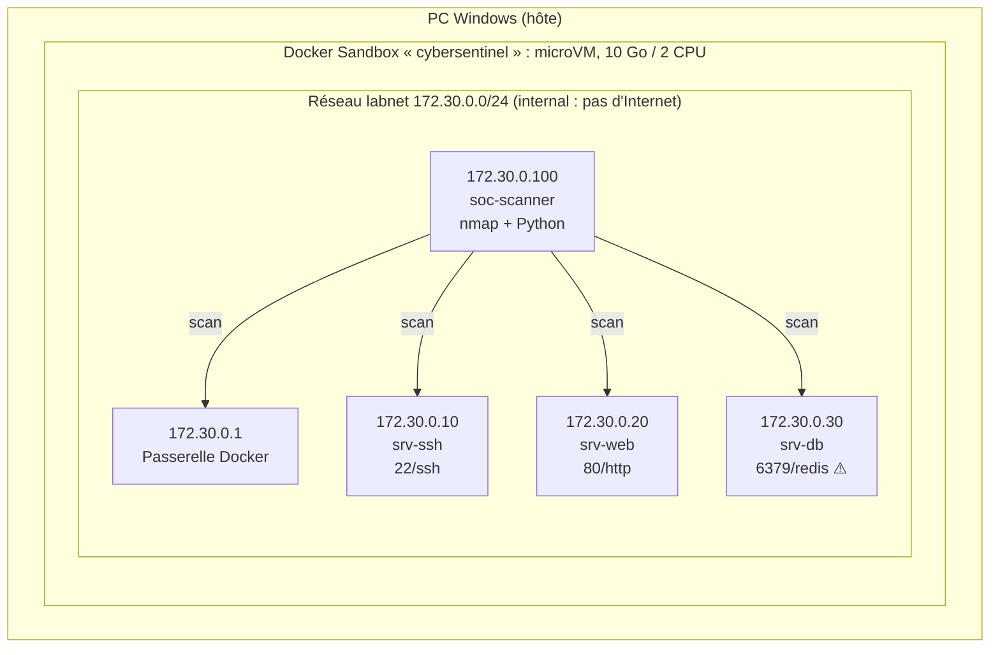

# Étape 1 : Découverte et inventaire des actifs

## Objectif
« On ne peut pas protéger ce qu'on ne connaît pas. » Identifier toutes les machines du réseau, leurs adresses, et les services qu'elles exposent, puis produire un **inventaire** et une **cartographie**.

## 1. Le laboratoire

Défini dans `lab/docker-compose.yml`, lancé dans la sandbox :
```bash
docker compose up -d --build
```

| Machine | IP | Rôle | Limite RAM |
|---|---|---|---|
| srv-ssh | 172.30.0.10 | Serveur Linux + SSH (cible du scénario brute force, étape 3) | 256 Mo |
| srv-web | 172.30.0.20 | Serveur web nginx | 64 Mo |
| srv-db | 172.30.0.30 | Base Redis **volontairement mal configurée** (sans mot de passe) | 64 Mo |
| soc-scanner | 172.30.0.100 | Poste d'analyse (nmap + Python) | 256 Mo |

**Réseau `internal: true`.** Le réseau du labo n'a aucune route vers Internet. Vérifié :
```
$ docker compose exec scanner ping -c 2 8.8.8.8
ping: connect: Network is unreachable
```

**`mem_limit`.** Chaque conteneur a un plafond de RAM. La sandbox n'a pas de swap : un conteneur qui dépasse sa limite est arrêté, au lieu de ralentir tout le labo. Consommation réelle mesurée : 2 à 4 Mo par cible.

## 2. La découverte en deux temps

**a) Découverte des hôtes** (qui est allumé ?)
```bash
docker compose exec scanner nmap -sn 172.30.0.0/24
```
`-sn` = « ping scan » : nmap ne regarde pas les ports, seulement quels hôtes répondent. Résultat : 5 hôtes. Le 5e (`.1`) est la **passerelle Docker** : un actif réel qu'on n'avait pas déclaré.

**b) Découverte des services** (qu'est-ce qui est exposé ?)
Script `discovery/discover.py` :
```bash
docker compose exec scanner python3 discover.py
```
Il lance :
```
nmap -p- -sV --version-light -T4 -oX - 172.30.0.0/24
```

| Option | Signification |
|---|---|
| `-p-` | Scanner les 65 535 ports TCP (pas seulement les 1000 courants) |
| `-sV` | Identifier le logiciel et sa version derrière chaque port ouvert |
| `--version-light` | Détection de version rapide (moins de sondes) |
| `-T4` | Vitesse élevée (adaptée à un réseau local) |
| `-oX -` | Sortie au format XML, lue ensuite par le script Python |

Le script transforme le XML en inventaire et ajoute une **observation de sécurité** par service.

## 3. Leçon importante : l'angle mort du scan par défaut

Au premier scan (sans `-p-`), **Redis n'a pas été détecté**. Nmap ne scanne par défaut que les 1000 ports les plus courants, et 6379 n'en fait pas partie. Le service était là, mais invisible.

C'est exactement ce qu'un attaquant exploite : un service sur un port inhabituel échappe aux scans rapides. **Un inventaire fiable exige un scan complet des ports.**

## 4. Inventaire (livrable)

| IP | Nom | Rôle | Service | Version | Observation |
|---|---|---|---|---|---|
| 172.30.0.1 | — | Passerelle Docker | aucun | — | — |
| 172.30.0.10 | srv-ssh | Cible | 22/ssh | OpenSSH 10.0p2 Debian | Surveiller le brute force |
| 172.30.0.20 | srv-web | Cible | 80/http | nginx 1.31.8 | Trafic en clair |
| 172.30.0.30 | srv-db | Cible | 6379/redis | Redis 7 | Vérifier l'authentification |
| 172.30.0.100 | soc-scanner | Poste SOC | aucun | — | — |

Fichiers générés dans `discovery/output/` (non versionnés, car régénérables) :
- `inventaire.json` : données structurées, pour le SIEM (étape 2) ;
- `inventaire.csv` : une ligne par service, pour un tableur ;
- `inventaire.md` : tableau lisible.

## 5. Cartographie (livrable)



## Questions probables du jury
- *Pourquoi le scanner est-il dans le labo et pas sur le PC ?* → Pour ne scanner que le réseau autorisé, et pour que le scan lui-même soit isolé.
- *Pourquoi `.1` apparaît alors qu'on ne l'a pas créé ?* → C'est la passerelle créée automatiquement par Docker pour le réseau. Un vrai inventaire trouve aussi ce qu'on n'a pas déclaré.
- *Pourquoi Redis est-il dangereux ici ?* → Sans mot de passe, n'importe qui sur le réseau peut lire ou modifier ses données, voire, dans certains cas, exécuter du code sur le serveur.
- *Pourquoi produire du JSON ?* → C'est le format qu'on enverra au SIEM à l'étape 2 : la découverte alimente directement la surveillance.
