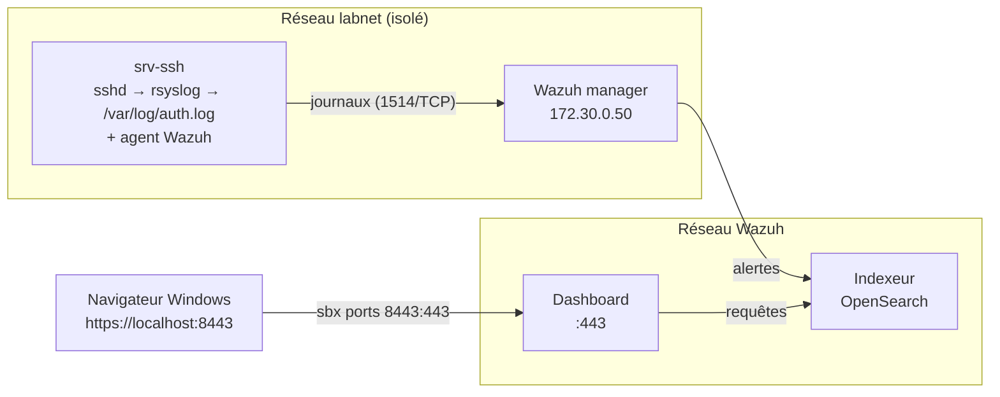

# Étape 2 : Intégration du SIEM/XDR (Wazuh)

## Objectif
Centraliser les informations de sécurité du labo dans une plateforme unique, capable de collecter les journaux, de les analyser et de produire des alertes.

## Pourquoi Wazuh ?
- Open source (GPLv2), gratuit, très utilisé en SOC.
- À la fois **SIEM** (collecte et corrélation de journaux) et **XDR** (agents sur les machines, audit de configuration, réponse active).
- Règles de détection intégrées, dont le brute force SSH (étape 3).

**Version : 4.14.9** (dernière stable, octobre 2026). Choix volontaire : la faille critique **CVE-2026-25769** (CVSS 9.1) touche le manager Wazuh des versions 4.0.0 à 4.14.2. Utiliser une version à jour fait partie de la sécurité du SOC lui-même.

## Architecture

| Composant | Rôle | Limite RAM | RAM mesurée |
|---|---|---|---|
| **Indexeur** (OpenSearch) | Base de données qui stocke et indexe les événements | 2 Go (Java : 1 Go) | ~1,3 Go |
| **Manager** | Reçoit les journaux des agents, applique les règles, génère les alertes | 1 Go | ~320 Mo |
| **Dashboard** | Interface web (recherche, visualisation) | 1 Go | ~240 Mo |
| **Agent** (sur srv-ssh) | Lit les journaux de la machine et les envoie au manager | inclus dans 512 Mo | — |



## Ce qui a été fait

**1. Installation reproductible.** On ne copie pas Wazuh dans notre dépôt. On versionne :
- `lab/siem/docker-compose.override.yml` : nos réglages (limites RAM, mémoire Java, liaison au réseau du labo) ;
- `scripts/setup-siem.sh` : télécharge la version officielle figée (tag `v4.14.9`), applique nos réglages, génère les certificats et démarre la stack.

Le **fichier override** est une fonctionnalité de Docker Compose : il est fusionné automatiquement avec le fichier officiel. On modifie le comportement sans toucher au code de Wazuh, ce qui rend les mises à jour simples.

**2. Certificats TLS.** Les composants communiquent en HTTPS chiffré. Le générateur officiel crée une autorité de certification (`root-ca.pem`) et un certificat par composant.

**3. Agent sur srv-ssh.** Ajout dans l'image de `srv-ssh` :
- **rsyslog** : écrit les journaux SSH dans `/var/log/auth.log` au format syslog standard (date, hôte, programme, message), le format que les décodeurs Wazuh savent lire ;
- **l'agent Wazuh** (même version que le manager), enregistré automatiquement auprès du manager `172.30.0.50`.

Vérification :
```
$ docker exec single-node-wazuh.manager-1 /var/ossec/bin/agent_control -l
   ID: 001, Name: srv-ssh, IP: any, Active
```

**4. Accès au dashboard depuis Windows.**
```powershell
sbx ports cybersentinel --publish 8443:443
```
Sans IP précisée, le port est lié à `127.0.0.1` : seul le PC hôte y a accès, pas le reste du réseau.

## Problèmes rencontrés (et leçons)

| Problème | Cause | Solution |
|---|---|---|
| Génération des certificats impossible | `packages.wazuh.com` bloqué par la politique réseau | `sbx policy allow network packages.wazuh.com` |
| Dashboard en erreur 500 | Indexeur incapable d'écrire : **`No space left on device`** | Disque Docker de la sandbox limité à 10 Go par défaut, plein à 100 %. Recréation avec `sbx settings set sandbox.disk.dockerVolume 30g` |
| `find: command not found` pendant les certificats | Commande de nettoyage absente de l'image du générateur | Sans conséquence : certificats bien créés |

**Leçon du disque plein :** le symptôme visible (erreur 500 du dashboard) n'avait rien à voir avec la cause réelle (disque plein de l'indexeur). Il a fallu remonter la chaîne : dashboard → logs de l'indexeur → `IOException` → `df -h` du bon disque (`/var/lib/docker`, et non `/`). C'est la démarche normale de diagnostic d'un SOC.

**Prérequis ajouté pour l'équipe** (avant de créer la sandbox) :
```powershell
sbx settings set sandbox.disk.dockerVolume 30g
```

## Points d'amélioration connus
- Mots de passe par défaut de Wazuh (`admin` / `SecretPassword`) à changer. Risque limité ici car le dashboard n'est accessible que depuis `localhost`.
- L'inventaire JSON de l'étape 1 peut être envoyé dans l'indexeur pour croiser actifs et alertes.

## Questions probables du jury
- *Quelle différence entre SIEM et XDR ?* → Le SIEM centralise et corrèle les journaux. L'XDR ajoute des agents sur les machines (visibilité, audit de configuration, réponse).
- *Pourquoi un agent plutôt que d'envoyer les logs directement ?* → L'agent chiffre et met en file les envois, surveille l'intégrité des fichiers et audite la configuration (module SCA).
- *Pourquoi rsyslog dans le conteneur ?* → Sans lui, sshd n'écrit pas ses journaux au format syslog, que les décodeurs Wazuh attendent.
