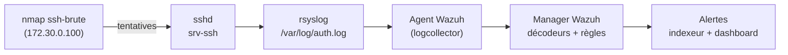

# Étape 3 : Surveillance et détection (brute force SSH)

## Objectif
Simuler une attaque réaliste et contrôlée, et vérifier que le SOC la détecte et produit des alertes.

## Le scénario : attaque par force brute SSH
Une **attaque par force brute** consiste à essayer de nombreuses combinaisons utilisateur / mot de passe jusqu'à en trouver une qui fonctionne. SSH est une cible classique : il est souvent exposé et donne un accès complet à la machine.

| Rôle | Machine | IP |
|---|---|---|
| Attaquant | soc-scanner | 172.30.0.100 |
| Victime | srv-ssh | 172.30.0.10 |
| Défenseur | Wazuh (agent + manager) | 172.30.0.50 |

## Déroulement

**1. Listes de test** (dans `discovery/`) : 6 utilisateurs courants (`root`, `admin`, `oracle`…) et 6 mots de passe parmi les plus utilisés (`123456`, `password`…).

**2. Attaque** avec le script NSE `ssh-brute` de nmap (déjà présent dans le scanner, rien à installer) :
```bash
docker compose exec scanner nmap -p 22 --script ssh-brute \
  --script-args userdb=/work/users.txt,passdb=/work/pass.txt,brute.firstonly=true \
  172.30.0.10
```
Résultat : **40 essais en 196 secondes, aucun compte trouvé**. Le mot de passe de `labuser` n'était pas dans la liste.

**3. Trace côté victime** (`/var/log/auth.log`) :
```
Failed password for invalid user oracle from 172.30.0.100 port 48124 ssh2
Failed password for labuser from 172.30.0.100 port 48128 ssh2
```

**4. La chaîne de détection**


## Résultat : alertes générées

| Alerte Wazuh | Nombre | Signification |
|---|---|---|
| **sshd: brute force trying to get access to the system** | **3** | Règle de **corrélation** : nombreux échecs depuis la même source en peu de temps |
| PAM: Multiple failed logins in a small period of time | 5 | Même corrélation, vue par le système d'authentification (PAM) |
| sshd: Attempt to login using a non-existent user | 51 | Tentatives sur des comptes inexistants |
| sshd: authentication failed / PAM: User login failed | 47 | Mauvais mot de passe sur un compte existant |

**Notion clé : événement vs corrélation.**
- Un échec de connexion isolé est un **événement** (un utilisateur peut se tromper de mot de passe).
- **Beaucoup** d'échecs, depuis **la même IP**, dans **un court délai** forment une **corrélation** : c'est ce qui caractérise une attaque. Wazuh a des règles qui comptent les événements dans une fenêtre de temps et lèvent une alerte de niveau plus élevé quand un seuil est dépassé.

**Bonus : audit de configuration (SCA).** Wazuh a aussi produit des alertes sur les options de montage (`nosuid`, `nodev`, `noexec`). Elles viennent du module **SCA** (Security Configuration Assessment), qui compare automatiquement la configuration de la machine aux recommandations **CIS**. Le SOC ne détecte pas seulement les attaques, il signale aussi les faiblesses de configuration.

## Vérification
```bash
docker exec single-node-wazuh.manager-1 sh -c \
  "grep -oE '\"description\":\"[^\"]*\"' /var/ossec/logs/alerts/alerts.json | sort | uniq -c | sort -rn | head"
```
Dans le dashboard : **Threat Hunting**, filtre sur l'agent `srv-ssh`.

## Pistes d'amélioration
- **Réponse active** : Wazuh peut bloquer automatiquement l'IP de l'attaquant (pare-feu) dès l'alerte de brute force. À n'activer qu'avec validation humaine (règle du projet).
- **Durcissement** : authentification SSH par clé, interdiction de `root`, limitation du nombre d'essais (`MaxAuthTries`), `fail2ban`.

## Questions probables du jury
- *L'attaque est-elle réaliste ?* → Oui : mêmes outils et mêmes listes que les attaques automatisées sur Internet, mais dans un réseau isolé et contre nos propres machines.
- *Pourquoi l'attaque a échoué ?* → Le mot de passe de `labuser` n'est pas un mot de passe courant. Une attaque par dictionnaire ne trouve que les mots de passe faibles.
- *Comment éviter les faux positifs ?* → Grâce aux seuils de corrélation : un seul échec ne déclenche pas d'alerte de brute force, seule une série rapide le fait.
