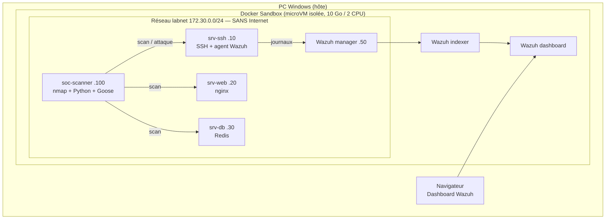

# CyberSentinel AI — Synthèse du projet

> Document de compréhension et de présentation. Il explique **tout le projet**, partie par partie, même les notions de base, et donne les **points à dire à l'oral**. Pour le détail technique de chaque étape, voir les fichiers `etape0` à `etape4` du dossier `docs/`.

**Projet :** Proof of Concept Blue Team / SOC — Master 2 Cybersécurité — novembre 2026.

---

## En une phrase

On a construit un **petit SOC complet dans un laboratoire isolé** : on découvre les machines d'un réseau, on simule une cyberattaque, un outil de sécurité (Wazuh) la détecte, et une **intelligence artificielle mène l'enquête** et rédige un rapport — le tout sous contrôle humain.

## La chaîne de défense démontrée

```
Découverte des actifs → Inventaire → Centralisation SIEM/XDR → Surveillance
                                → Détection → Investigation assistée par IA → Rapport
```

Le principe directeur, répété tout au long du projet : **on ne peut pas protéger ce qu'on ne connaît pas.**

## Vue d'ensemble de l'architecture



---

# Partie 0 — L'environnement : isolé et portable

### Ce qu'on a fait
Avant tout outil de sécurité, on a préparé un espace de travail **isolé** (rien ne sort vers Internet), **portable** (reconstructible sur n'importe quel PC) et **économe** (moins de 2 Go de RAM utilisés).

### Les notions de base
- **Git / GitHub** : un historique de toutes les versions du projet. Chacun « clone » le dépôt, travaille sur sa « branche », puis propose ses changements via une « Pull Request » relue par un coéquipier. → *Tout le projet tient dans un dépôt : c'est ça, la portabilité.*
- **Conteneur vs microVM** : un conteneur Docker est léger mais partage le noyau de l'ordinateur. Une **microVM** (Docker Sandboxes) a son **propre noyau** : si quelque chose tourne mal à l'intérieur, l'ordinateur n'est pas touché. → *C'est notre « mur » autour du laboratoire.*
- **Le fichier `.env`** : il contient les secrets (mots de passe, clé API). Il est exclu de Git, donc ne part jamais sur GitHub. On ne versionne qu'un modèle vide, `.env.example`.

### À dire à l'oral
> « On n'a pas installé les outils directement sur Windows. Sinon, nos scans toucheraient le vrai réseau, et l'IA aurait accès à la machine. Tout vit dans une sandbox jetable : en cas de problème, on la détruit et on la recrée depuis Git. »

---

# Partie 1 — Découverte et inventaire des actifs

### Ce qu'on a fait
Un laboratoire de 4 machines (serveur SSH, serveur web, base Redis, poste d'analyse) sur un réseau **interne** sans Internet. Puis un scan pour dresser l'**inventaire** et la **cartographie**.

### Comment ça marche
- **nmap** interroge chaque adresse IP pour voir quelles machines répondent et quels **ports** sont ouverts. Un port ouvert = un service accessible (22 = SSH, 80 = web, 6379 = Redis).
- Un script **Python** (`discover.py`) transforme le résultat en inventaire (JSON, CSV, Markdown) et ajoute une observation de sécurité par service.

### Les deux leçons fortes
1. **L'angle mort du scan par défaut.** nmap ne regarde que les 1000 ports les plus courants. Redis (port 6379) en est absent : il était **invisible** jusqu'à ce qu'on scanne tous les ports (`-p-`). → *Un attaquant exploite exactement ce genre d'oubli.*
2. **L'inventaire n'est jamais figé.** En relançant la découverte pendant la démo, une **6ᵉ machine est apparue** : le manager Wazuh lui-même, qu'on avait ajouté entre-temps. → *Même notre outil de défense fait partie de la surface à surveiller. On refait l'inventaire après chaque changement.*

### À dire à l'oral
> « On a trouvé 6 actifs, dont la passerelle Docker et notre propre serveur Wazuh, qu'on n'avait pas déclarés. Un bon inventaire trouve aussi ce qu'on a oublié. »

---

# Partie 2 — Le SIEM/XDR : Wazuh

### Ce qu'on a fait
Installé **Wazuh 4.14.9**, une plateforme open source qui **centralise** les journaux, les **analyse** et produit des **alertes**.

### Les notions de base
- **SIEM** = on collecte et on corrèle les journaux de tout le parc en un seul endroit.
- **XDR** = en plus, on met un **agent** sur chaque machine, qui surveille ses journaux, l'intégrité de ses fichiers et sa configuration.
- On a installé un **agent Wazuh sur `srv-ssh`** : c'est lui qui lit les tentatives de connexion et les envoie au manager.

### Comment l'information circule
```
sshd → rsyslog (/var/log/auth.log) → agent Wazuh → manager → indexeur → dashboard
```

### À dire à l'oral
> « Wazuh est à la fois le cerveau qui analyse et l'œil posé sur chaque machine. Sans l'agent, le serveur SSH pourrait se faire attaquer sans que personne ne le voie. »

*(Capture : `images/wazuh-overview.png` — l'agent actif et le total des alertes.)*

---

# Partie 3 — La détection : attaque par force brute SSH

### Ce qu'on a fait
Simulé une **attaque réaliste** depuis le poste scanner vers `srv-ssh` : essayer en boucle des couples utilisateur / mot de passe (`root`, `admin`, `oracle`… avec `123456`, `password`…). Puis vérifié que Wazuh la détecte.

### La notion clé : événement vs corrélation
- Un échec de connexion isolé est un **événement** banal (on se trompe tous de mot de passe).
- **Beaucoup** d'échecs, depuis **la même source**, en **peu de temps**, forment une **corrélation** : c'est la signature d'une attaque. Wazuh compte les événements dans une fenêtre de temps et lève une alerte de **niveau 10** quand un seuil est franchi.

### Le résultat
L'attaque a échoué (le bon mot de passe n'était pas dans la liste), **et** Wazuh l'a vue : alertes « *sshd: brute force trying to get access to the system* », technique **MITRE ATT&CK : Password Guessing / Brute Force**. Le dashboard montre **120 échecs d'authentification et 0 réussite**.

### À dire à l'oral
> « L'attaque a échoué parce que le mot de passe n'était pas un mot de passe faible — ça montre l'intérêt des mots de passe forts. Et surtout, le SOC l'a détectée en direct. »

*(Captures : `images/wazuh-auth-222.png` — 0 réussite ; `images/wazuh-alerte-detail.png` — une alerte niveau 10 dépliée.)*

---

# Partie 4 — L'investigation assistée par IA

### Ce qu'on a fait
Branché un **agent IA** (Goose, avec le modèle MiniMax de NVIDIA) sur les alertes Wazuh, via un **serveur MCP** qu'on a écrit, **en lecture seule**. L'IA mène l'enquête et rédige un rapport.

### Comment ça marche (le point central du projet)
```
Analyste : « Rapport sur les alertes SSH »
   │
   ▼
Goose ──(question + liste des 4 outils)──► Modèle IA (chez NVIDIA)
   │                                              │
   │         ◄── « appelle resume_alertes(24h) » ─┘
   │
   ├─ demande la validation à l'analyste  ← VALIDATION HUMAINE
   ▼
Serveur MCP ──(lecture seule)──► Wazuh ──► alertes
   │
   ▼
Goose ──► Modèle ──► rédige le rapport ──► Analyste
```

Trois garde-fous :
- **Le modèle ne touche jamais Wazuh.** Il *demande* un outil ; c'est Goose, dans la sandbox, qui l'exécute.
- **Il n'a que 4 outils, tous en lecture seule.** Il ne peut ni lancer de commande, ni bloquer une IP : ces outils n'existent pas.
- **Chaque appel est validé par un humain** (mode « approve »).

### Ce que l'IA a produit
Un rapport en 6 parties (résumé, chronologie, source/cible, interprétation, gravité, recommandations). Fait remarquable : **elle s'est posé seule la question clé d'une enquête — l'attaquant est-il entré ? — et a vérifié qu'aucune connexion n'avait réussi.** Elle a croisé les alertes avec l'inventaire, sans conclure d'elle-même que l'activité était autorisée.

### La session dans le terminal
L'IA planifie son enquête, puis **demande la permission avant chaque appel d'outil** :

```text
> Fais un rapport d'investigation sur les alertes SSH de la dernière heure.

  ▸ resume_alertes      wazuh   heures: 24
  ▸ activite_ip         wazuh   ip: 172.30.0.100, heures: 24
  ▸ rechercher_alertes  wazuh   groupe: authentication_success, limite: 5

  Tool approval request
    { "tool_name": "wazuh__resume_alertes",
      "arguments": { "heures": 24, "niveau_min": 0 } }

  Goose would like to call the above tool, do you allow?
  > Allow        (Allow the tool call once)
    Always Allow
    Deny
```

À chaque étape, l'analyste choisit **Allow**. Les outils étant en lecture seule, aucune action ne modifie le système. Le rapport complet rédigé ensuite est dans [`rapport-investigation-ia-2026-11-14.md`](rapport-investigation-ia-2026-11-14.md).

### La limite, et pourquoi l'humain reste indispensable
En relisant, on a trouvé des erreurs de l'IA : des résultats attribués au mauvais appel, et des **mots parasites en langue étrangère** glissés dans le texte français (chinois, espagnol, anglais). → *L'IA assiste et accélère, mais un humain valide chaque action et relit chaque rapport.*

### À dire à l'oral
> « L'IA ne remplace pas l'analyste : elle lui fait gagner du temps. Elle propose, elle explique, mais elle demande la permission avant d'agir, et on vérifie ce qu'elle écrit. »

---

# Partie 5 — Validation de bout en bout

Le scénario de démonstration (`demo-scenario.md`) enchaîne toute la chaîne en ~12 minutes :
1. **Isolation** : un ping vers Internet échoue.
2. **Découverte** : l'inventaire des actifs.
3. **Attaque** : le brute force SSH (lancé en parallèle).
4. **Détection** : les alertes dans le dashboard Wazuh.
5. **Investigation IA** : Goose mène l'enquête, sous validation humaine.

---

## Les principes de sécurité respectés

| Principe | Comment on l'applique |
|---|---|
| **Isolation** | Réseau du labo sans accès Internet ; sandbox à noyau propre |
| **Moindre privilège** | Politique réseau qui bloque tout sauf l'autorisé ; IA en lecture seule |
| **Validation humaine** | Chaque action de l'IA est approuvée par l'analyste |
| **Pas de donnée réelle** | Le labo n'utilise que des données de test |
| **Traçabilité** | Tout est journalisé dans Wazuh ; tout le code est historisé dans Git |

## Améliorations possibles (à mentionner au jury)

- **Réponse active** : Wazuh peut bloquer automatiquement l'IP d'un attaquant. À n'activer qu'avec validation humaine.
- **Mots de passe par défaut** de Wazuh à changer (risque limité ici car le dashboard n'est accessible que depuis l'ordinateur local).
- **Modèle IA hébergé en local**, pour qu'aucune donnée ne sorte vers un service externe.
- **Durcissement SSH** : authentification par clé, interdiction de `root`, limitation du nombre d'essais.

## Les questions probables du jury (réponses courtes)

- *Pourquoi une sandbox et pas Windows directement ?* → Pour isoler les scans et l'IA ; et parce que la sandbox est jetable et reproductible.
- *Différence SIEM / XDR ?* → Le SIEM centralise les journaux ; l'XDR ajoute des agents sur les machines.
- *Pourquoi l'IA ne bloque-t-elle pas l'attaquant elle-même ?* → Une IA se trompe (on l'a vu). Une mauvaise action pourrait couper un service légitime. L'IA recommande, l'humain décide.
- *Qu'apporte MCP ?* → Un standard : notre serveur fonctionnerait avec d'autres agents IA, sans tout réécrire.
- *Et si la clé API fuit ?* → Elle n'est que dans `.env` (hors Git) ; en cas de fuite, on la révoque et on en génère une nouvelle.

---

*Dépôt du projet : `CaptaineNemo1995/IA-Project-digitalisation`. Documentation détaillée : dossier `docs/`.*
